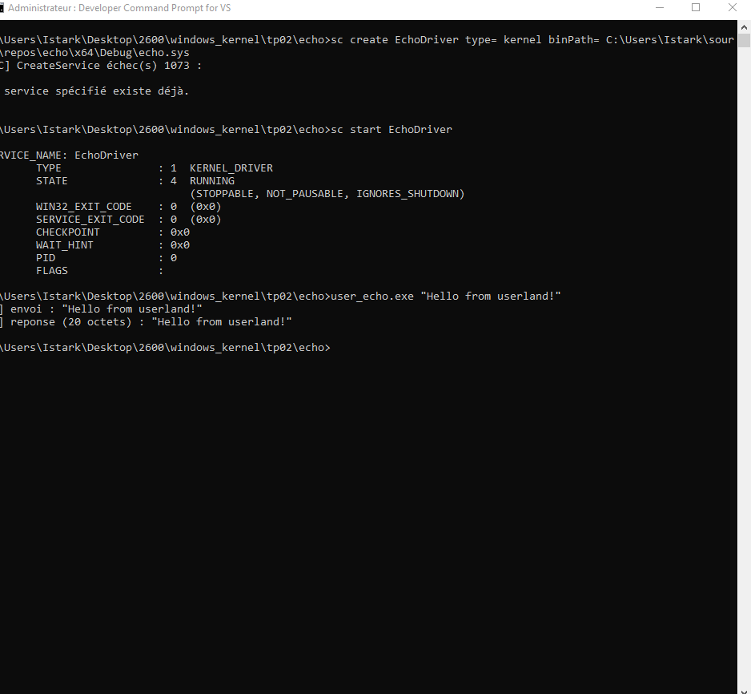
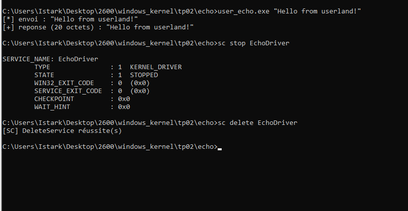
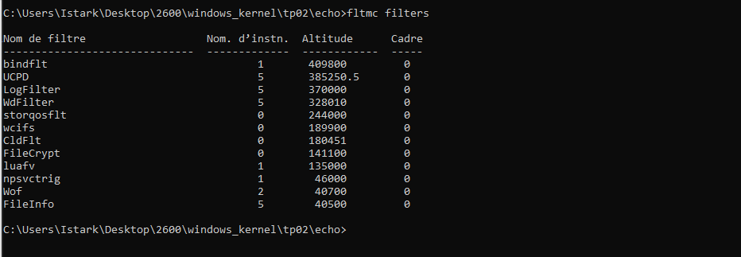
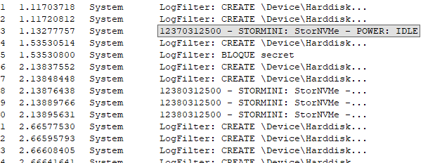
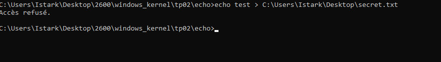

# TP02 - Driver Echo et MiniFilter

**Auteur :** Istark  
**Date :** Octobre 2026

---

## Exercice 1 - Echo Driver

### Objectif

L'idée de cet exercice c'etait d'écrire un driver kernel qui expose un device IOCTL, et un programme userland qui lui envoie une chaine de caractères. Le driver doit renvoyer la meme chaine en retour (echo).

### Architecture

Le driver EchoDriver crée deux choses :
- Un device : `\Device\EchoDriver`
- Un lien symbolique : \\.`\EchoDriverLink` (pour acceder depuis l'userland)

Il enregistre les MajorFunction IRP_MJ_CREATE, IRP_MJ_CLOSE et IRP_MJ_DEVICE_CONTROL.

**Code source echo.c :**

```c
NTSTATUS EchoDeviceControl(_In_ PDEVICE_OBJECT DeviceObject, _In_ PIRP Irp)
{
    PIO_STACK_LOCATION stackLocation;
    NTSTATUS status = STATUS_SUCCESS;
    ULONG_PTR information = 0;

    stackLocation = IoGetCurrentIrpStackLocation(Irp);

    switch(stackLocation->Parameters.DeviceIoControl.IoControlCode) {
    case IOCTL_ECHO:
    {
        PVOID systemBuffer = Irp->AssociatedIrp.SystemBuffer;
        ULONG inputLength  = stackLocation->Parameters.DeviceIoControl.InputBufferLength;
        ULONG outputLength = stackLocation->Parameters.DeviceIoControl.OutputBufferLength;
        ULONG copyLength   = (inputLength < outputLength) ? inputLength : outputLength;

        if (systemBuffer == NULL || copyLength == 0) {
            status = STATUS_INVALID_PARAMETER;
            break;
        }

        DbgPrint("Echo: recu %lu octets : %.*s\n",
                 inputLength, (int)inputLength, (PCHAR)systemBuffer);
        RtlCopyMemory(systemBuffer, systemBuffer, copyLength);
        information = copyLength;
        break;
    }
    default:
        status = STATUS_INVALID_DEVICE_REQUEST;
        break;
    }

    Irp->IoStatus.Status = status;
    Irp->IoStatus.Information = information;
    IoCompleteRequest(Irp, IO_NO_INCREMENT);
    return status;
}
```

### Q1 - Pourquoi METHOD_BUFFERED

METHOD_BUFFERED c'est la methode la plus sure. L'I/O Manager copie lui-meme les buffers userland dans un buffer kernel intermediaire (SystemBuffer) avant que le driver y accede. Le driver touche jamais directement une adresse userland ce qui evite beaucoup de problemes.

Les autres methodes et leurs risques :

- **METHOD_IN_DIRECT / METHOD_OUT_DIRECT** : le buffer de sortie est accedé via une MDL mappée directement. Le driver doit valider lui-meme la taille et l'accessibilitée, une erreur peut mener a un acces hors limites
- **METHOD_NEITHER** : aucune validation par l'I/O Manager. Le driver recoit les pointeurs bruts du userland. Il faut appeller ProbeForRead/ProbeForWrite et gérer les TOCTOU manuellement. C'est la methode la plus dangereuse et la source classique de vulns dans les drivers tiers

### Q2 - Oubli de IoCompleteRequest

Si on oublie d'appeller IoCompleteRequest, l'IRP reste en attente indéfiniment. Coté userland DeviceIoControl ne retourne jamais, le thread reste bloqué. Si beaucoup d'IRPs s'accumulent comme ca, ca peut epuiser les ressources. Et au dechargement du driver on risque un BSOD car le systeme trouve des IRPs encore en vol dans un module qui se decharge.

### Q3 - Breakpoint WinDBG sur la dispatch function

Apres sc start EchoDriver et avec un breakpoint sur EchoDriver!EchoDeviceControl :

```
kd> bp EchoDriver!EchoDeviceControl
kd> g
```

Quand user_echo.exe envoie le message, WinDBG s'arrete sur le breakpoint. On peut ensuite inspecter l'IRP avec dt _IRP et voir le SystemBuffer avec db. Le buffer contient la chaine envoyée depuis l'userland.

### Résultats



Le driver démare correctement (STATE: 4 RUNNING) et le test user_echo.exe "Hello from userland!" fonctionne.



On voit bien que le programme recoit 20 octets en retour, c'est la meme chaine qu'on a envoyé.

---

## Exercice 2 - MiniFilter de logging et blocage

### Objectif

Ecrire un minifilter qui :
1. Log toutes les operations IRP_MJ_CREATE dans DebugView
2. Bloque l'acces aux fichiers dont le nom contient "secret" (bonus)

### Architecture

Le minifilter s'enregistre avec FltRegisterFilter puis FltStartFiltering. Il installe une callback PreCreateCallback qui tourne avant chaque IRP_MJ_CREATE.

**Code source filter.c :**

```c
FLT_PREOP_CALLBACK_STATUS
PreCreateCallback(
    _Inout_ PFLT_CALLBACK_DATA Data,
    _In_ PCFLT_RELATED_OBJECTS FltObjects,
    _Flt_CompletionContext_Outptr_ PVOID *CompletionContext)
{
    NTSTATUS status;
    PFLT_FILE_NAME_INFORMATION nameInfo = NULL;
    BOOLEAN shouldBlock = FALSE;

    status = FltGetFileNameInformation(Data,
        FLT_FILE_NAME_NORMALIZED | FLT_FILE_NAME_QUERY_DEFAULT,
        &nameInfo);
    if (!NT_SUCCESS(status)) return FLT_PREOP_SUCCESS_NO_CALLBACK;

    FltParseFileNameInformation(nameInfo);
    DbgPrint("LogFilter: CREATE %wZ\n", &nameInfo->Name);

    if (wcsstr(nameInfo->Name.Buffer, L"secret") != NULL)
        shouldBlock = TRUE;

    FltReleaseFileNameInformation(nameInfo);

    if (shouldBlock) {
        DbgPrint("LogFilter: BLOQUE secret\n");
        Data->IoStatus.Status = STATUS_ACCESS_DENIED;
        return FLT_PREOP_COMPLETE;
    }
    return FLT_PREOP_SUCCESS_NO_CALLBACK;
}
```

### Q4 - Altitude d'un minifilter

L'altitude c'est un numéro unique qui definit la position relative du filtre dans la pile du Filter Manager. Plus le numero est elevé, plus le filtre est proche de l'application (il voit les requetes en premier).

Notre filtre est enregistré a l'altitude 370000 (plage FSFilter Activity Monitor). C'est la meme plage que les EDR et antivirus, ce qui fait qu'on intercepte les operations avant les filtres de chiffrement ou compression.

Si deux minifilters ont la meme altitude, le deuxieme echoue a l'enregistrement avec une erreur de collision. L'altitude doit etre unique sur tout le systeme.



On voit LogFilter bien enregistré avec son altitude, a cote des autres filtres systeme (bindflt, UCPD, WdFilter...).

### Q5 - Nombre d'IRP_MJ_CREATE pour un fichier Notepad

En pratique on observe entre 5 et 15 operations IRP_MJ_CREATE pour l'ouverture d'un seul fichier. Ce nombre est bien superieur a 1 parce que :

- Notepad verifie d'abord les attributs du fichier avant de l'ouvrir vraiment
- Windows lit les flux alternatifs (Zone.Identifier pour les fichiers telecharges)
- L'antivirus ouvre aussi le fichier pour l'analyser
- L'indexeur Windows Search peut déclencher des ouvertures supplementaires
- La resolution du chemin implique parfois des ouvertures intermediaires



On voit bien dans DebugView que le filtre log toutes les opérations CREATE, et qu'il bloque explicitement les fichiers "secret".

### Q6 - Blocage des fichiers "secret" (bonus)

Le minifilter bloque bien l'acces a C:`\secret_data`.txt. Pour le chemin court (8.3) : on utilise FLT_FILE_NAME_NORMALIZED qui resout les alias courts vers le nom long avant la comparaison. Le mot "secret" apparait toujours dans le nom normalisé donc le blocage s'applique quand meme.



La commande echo test > C:\...`\secret`.txt retourne bien "Accès refusé", la protection fonctionne correctement.

---

*Toutes les manipulations ont été faites sur une VM de test isolée.*
