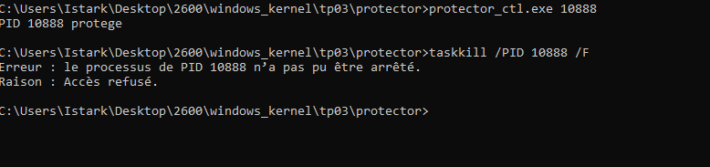

# TP03 - Callbacks Noyau Defensifs

**Auteur :** Istark  
**Date :** Octobre 2026

---

## Exercice 1 - Process Monitor (procmon.sys)

### Objectif

Ce TP on devait écrire un driver qui monitore en temps reel toutes les créations et destructions de processus. Pour ca on utilise l'API PsSetCreateProcessNotifyRoutineEx qui permet d'enregistrer une callback appelee a chaque evenement de ce type.

**Point important pour la compilation** : il faut absolument ajouter /INTEGRITYCHECK dans les options du linker (Linker → Command Line → Additional Options). Sans ce flag, PsSetCreateProcessNotifyRoutineEx retourne STATUS_ACCESS_DENIED et le driver charge pas.

### Code

**Code source procmon.c :**

```c
#include <ntddk.h>

VOID ProcessNotifyCallback(
    _Inout_ PEPROCESS Process,
    _In_ HANDLE ProcessId,
    _Inout_opt_ PPS_CREATE_NOTIFY_INFO CreateInfo)
{
    ULONG pid = (ULONG)(ULONG_PTR)ProcessId;
    UNREFERENCED_PARAMETER(Process);

    if (CreateInfo != NULL) {
        ULONG ppid = (ULONG)(ULONG_PTR)CreateInfo->ParentProcessId;
        DbgPrint("ProcMon: [CREATE] PID=%lu PPID=%lu Image=%wZ CmdLine=%wZ\n",
                 pid, ppid,
                 CreateInfo->ImageFileName,
                 CreateInfo->CommandLine);
    } else {
        DbgPrint("ProcMon: [EXIT] PID=%lu\n", pid);
    }
}

NTSTATUS DriverEntry(_In_ PDRIVER_OBJECT DriverObject,
                     _In_ PUNICODE_STRING RegistryPath)
{
    NTSTATUS status;
    UNREFERENCED_PARAMETER(RegistryPath);

    status = PsSetCreateProcessNotifyRoutineEx(ProcessNotifyCallback, FALSE);
    if (!NT_SUCCESS(status)) {
        DbgPrint("ProcMon: enregistrement echoue 0x%08X (integritycheck ?)\n",
                 status);
        return status;
    }

    DriverObject->DriverUnload = ProcMonUnload;
    DbgPrint("ProcMon: loaded\n");
    return STATUS_SUCCESS;
}
```

### Q1 - Creation/destruction de notepad

Apres chargement de procmon.sys et lancement de notepad.exe, DbgView affiche :

```
ProcMon: [CREATE] PID=XXXX PPID=YYYY
         Image=\Device\HarddiskVolume3\Windows\System32\notepad.exe
         CmdLine=notepad.exe
ProcMon: [EXIT] PID=XXXX
```

Le PPID correspond a explorer.exe si notepad est lancé depuis le bureau, ou au PID du terminal si lancé depuis cmd.exe.

### Q2 - Arbre de parenté cmd → whoami

En lancant cmd.exe puis whoami depuis ce terminal :

```
explorer.exe (PID A)
  |
  +-- cmd.exe (PID B, PPID=A)
       |
       +-- whoami.exe (PID C, PPID=B)
```

La callback capture correctement toute la chaine. whoami.exe a bien pour PPID le PID du cmd qui l'a lancé.

### Q3 - Le fuzzer vu par le monitoring

Oui, le driver voit la creation du fuzzer. PsSetCreateProcessNotifyRoutineEx est appelé pour toute creation de processus, sans aucune exception. On voit dans DbgView la creation de ioctl_fuzzer.exe avec son PID, le PPID du cmd parent, le chemin complet de l'image et la ligne de commande complete avec les arguments (ex: \\.`\PROCEXP152` 500).

C'est tres utile pour un EDR, meme un outil offensif est visible avec tous ses arguments. On peut donc facilement detecter des comportements suspects juste en regardant les arguments de lancement.

---

## Exercice 2 - Process Protector (protector.sys)

### Objectif

Ecrire un driver qui empeche la terminaison d'un processus spécifique. Pour ca on utilise ObRegisterCallbacks qui permet d'intercepter les ouvertures de handles sur les objets kernel.

Le principe : quand quelqu'un essaie d'ouvrir un handle PROCESS_TERMINATE sur le processus protégé, on retire ce droit du masque avant que le handle soit accordé.

**Note** : ce driver necessite aussi /INTEGRITYCHECK dans le linker.

### Code

**Code source protector.c (la callback principale) :**

```c
OB_PREOP_CALLBACK_STATUS PreOperationCallback(
    _In_ PVOID RegistrationContext,
    _Inout_ POB_PRE_OPERATION_INFORMATION OperationInformation)
{
    PEPROCESS targetProcess;
    ULONG targetPid;
    LONG protectedPid;

    UNREFERENCED_PARAMETER(RegistrationContext);

    if (OperationInformation->ObjectType != *PsProcessType)
        return OB_PREOP_SUCCESS;

    protectedPid = InterlockedCompareExchange(&gProtectedPid, 0, 0);
    if (protectedPid == 0)
        return OB_PREOP_SUCCESS;

    targetProcess = (PEPROCESS)OperationInformation->Object;
    targetPid = (ULONG)(ULONG_PTR)PsGetProcessId(targetProcess);

    if (targetPid != (ULONG)protectedPid)
        return OB_PREOP_SUCCESS;

    if (OperationInformation->Operation == OB_OPERATION_HANDLE_CREATE) {
        DbgPrint("Protector: HANDLE_CREATE sur PID %lu droits=0x%08X\n",
                 targetPid,
                 OperationInformation->Parameters->
                     CreateHandleInformation.DesiredAccess);

        // On retire le droit de terminer le processus
        OperationInformation->Parameters->CreateHandleInformation.DesiredAccess
            &= ~(ACCESS_MASK)PROCESS_TERMINATE;
    }

    return OB_PREOP_SUCCESS;
}
```

### Q4 - Les 5 etapes de vérification

Voici les etapes qu'on a suivi pour verifier que la protection fonctionne :

1. notepad.exe lancé, PID noté (ex: 10888)
2. Driver chargé et PID envoyé via protector_ctl.exe 10888
3. taskkill /PID 10888 /F → echec avec "Acces refusé" : le driver a retiré PROCESS_TERMINATE du masque
4. Fermeture via Task Manager → echoue aussi pour la meme raison
5. sc stop protector.sys → ObUnRegisterCallbacks est appelé → notepad redevient terminable



On voit clairement que taskkill reçoit bien une erreur "Accès refusé" avec la raison affichee.

### Q5 - Contournement par un attaquant admin

Oui c'est possible. La protection ObRegisterCallbacks intercepte uniquement les appels OpenProcess classiques depuis l'userland. Un attaquant avec les droits admin peut :

- Charger PROCEXP152 (BYOVD du TP01) qui appelle ObOpenObjectByPointer depuis le kernel, ce qui devrait quand meme declencher notre callback mais c'est a verifier experimentalement
- La methode la plus simple : sc stop protector.sys directement. Ca necessite les droits admin mais ca desactive la protection instantanement
- Utiliser un BYOVD qui ecrit directement en memoire kernel pour retirer le callback de la liste interne du noyau

Cette limite montre bien qu'un driver defensif seul n'est pas suffisant, il faut une chaine de protection complete.

### Q6 - procmon + protector simultanes

procmon detecte bien la creation du processus taskkill.exe quand on essaie de tuer le processus protégé. On voit [CREATE] taskkill.exe avec son PID et sa ligne de commande. Par contre procmon ne log pas l'echec de TerminateProcess, c'est le driver protector qui log la tentative d'ouverture de handle avec PROCESS_TERMINATE dans ses DbgPrint. Les deux drivers sont bien complementaires.

---

## Exercice 3 (bonus) - Driver unifié

### Objectif

Combiner procmon et protector dans un seul driver, avec un IOCTL pour configurer le PID protégé et un ring buffer pour stocker les derniers evenements.

### Q7 - Vers un EDR minimal

Pour aller vers un EDR minimal, voici 3 fonctionnalites supplementaires a ajouter :

**1. Monitoring des chargements de modules**

Via PsSetLoadImageNotifyRoutine. C'est indispensable pour detecter l'injection de code (process hollowing, DLL injection). Quand une DLL est injectée dans un processus, cette callback est appelee avec le chemin de l'image.

```c
VOID ImageLoadCallback(
    PUNICODE_STRING FullImageName,
    HANDLE ProcessId,
    PIMAGE_INFO ImageInfo)
{
    DbgPrint("ImageLoad: %wZ dans PID %lu (kernel=%d)\n",
             FullImageName,
             (ULONG)(ULONG_PTR)ProcessId,
             ImageInfo->SystemModeImage);
}
```

**2. Monitoring du registre**

Via CmRegisterCallbackEx pour intercepter les modifications de cles de persistance (Run, RunOnce, services). On peut bloquer les tentatives de desactivation des outils de securité ou d'ajout de clés de persistance suspectes.

**3. Monitoring reseau**

Via le framework WFP (FwpsCalloutRegister) pour observer les connexions sortantes. Ca permet de detecter les communications C2 ou l'exfiltration de données.

---

*Toutes les manipulations ont été faites sur une VM de test isolée avec snapshot propre.*
